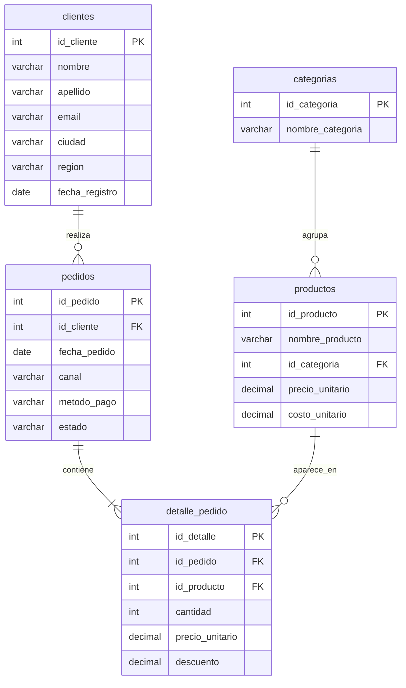

# Análisis de ventas de una tienda en línea | SQL (MySQL)

Análisis en SQL de las ventas de una tienda en línea ficticia con operación en 8 ciudades de Colombia, entre enero de 2024 y diciembre de 2025. El proyecto responde **20 preguntas de negocio y 8 retos** organizados en 4 niveles de dificultad, desde consultas básicas hasta CTEs y funciones de ventana.

> Los datos son ficticios y se generaron para este proyecto. No corresponden a ninguna empresa real.

## Modelo de datos



| Tabla | Registros |
| --- | --- |
| `clientes` | 500 |
| `pedidos` | 3.052 |
| `detalle_pedido` | 5.761 |
| `productos` | 40 |
| `categorias` | 5 |

**Definición de venta:** `cantidad × precio_unitario × (1 − descuento)`, solo para pedidos con estado *Entregado*.

## Hallazgos principales

- **Las ventas crecieron 23 % en 2025.** Pasaron de $479,4 millones en 2024 a $591,4 millones en 2025, y el ticket promedio por pedido subió 5 % (de $387.574 a $408.693).
- **El 17 % de los clientes genera casi la mitad de las ventas.** Los 70 clientes VIP (más de $5 millones en compras) aportan el 48 % de los ingresos. Retenerlos debería ser una prioridad.
- **Una categoría depende de un solo producto.** La bicicleta estática genera el 68 % de las ventas de Deportes, lo que concentra el riesgo de esa categoría.
- **Fuerte estacionalidad de fin de año.** Noviembre y diciembre concentran el 25 % de las ventas anuales; diciembre de 2025 fue el mejor mes del periodo ($84 millones).
- **Bogotá y Medellín suman el 51 % de las ventas.** Tecnología es la categoría que más vende (26 %), pero Deportes (+35 %) y Moda (+32 %) son las que más crecieron.
- **Oportunidades de mejora:**
    - 78 clientes registrados (16 %) nunca han comprado: son candidatos para una campaña de activación.
    - 3 productos no registran ninguna venta: conviene revisarlos en el catálogo.
    - La página web tiene la mayor tasa de cancelaciones y devoluciones (12,9 %).
    - En promedio, un cliente vuelve a comprar cada 57 días, un dato útil para programar campañas de recompra.

## Preguntas de negocio por nivel

| Nivel | Técnicas | Ejemplos de preguntas |
| --- | --- | --- |
| 1. Consultas a una tabla | `SELECT`, `WHERE`, `ORDER BY`, `GROUP BY`, `LIMIT`, `IS NULL` | Clientes por ciudad, pedidos por estado, clientes sin correo |
| 2. Unión de tablas | `INNER JOIN`, `LEFT JOIN`, `COUNT(DISTINCT)`, `CONCAT` | Ventas por año y categoría, top 10 clientes, clientes sin compras |
| 3. Grupos y subconsultas | `HAVING`, `CASE`, subconsultas en `WHERE` y `FROM` | Tasa de cancelación por canal, ticket promedio, segmentación de clientes |
| 4. Análisis avanzado | CTE (`WITH`), `LAG`, `RANK`, `ROW_NUMBER`, `SUM() OVER` | Crecimiento mes a mes, top 3 por categoría, acumulado anual, días entre compras |

## Ejemplo: segmentación de clientes

```sql
SELECT CASE
           WHEN total_comprado >= 5000000 THEN 'VIP'
           WHEN total_comprado >= 1000000 THEN 'Frecuente'
           ELSE 'Ocasional'
       END AS segmento,
       COUNT(*) AS clientes,
       ROUND(SUM(total_comprado)) AS ventas
FROM (
    SELECT c.id_cliente,
           SUM(d.cantidad * d.precio_unitario * (1 - d.descuento)) AS total_comprado
    FROM clientes c
    JOIN pedidos p        ON c.id_cliente = p.id_cliente
    JOIN detalle_pedido d ON p.id_pedido = d.id_pedido
    WHERE p.estado = 'Entregado'
    GROUP BY c.id_cliente
) t
GROUP BY segmento
ORDER BY ventas DESC;
```

| segmento | clientes | ventas |
| --- | --- | --- |
| VIP | 70 | 515.706.575 |
| Frecuente | 205 | 488.970.440 |
| Ocasional | 138 | 66.130.955 |

## Cómo ejecutarlo

1. Abre MySQL Workbench (MySQL 8 o superior).
2. Ejecuta `01_crear_tablas.sql` para crear la base de datos `tienda_ventas` y sus tablas.
3. Ejecuta `02_insertar_datos.sql` para cargar los datos. Al final muestra el conteo de filas de cada tabla.
4. Abre `03_consultas.sql` y ejecuta las consultas una por una.

## Archivos

- `01_crear_tablas.sql`: creación de la base de datos, tablas y llaves
- `02_insertar_datos.sql`: datos de la tienda
- `03_consultas.sql`: las 20 preguntas de negocio y los 8 retos

## Herramientas

MySQL 8 · MySQL Workbench

## Autora

**Alejandra Osorio**, economista y analista de Business Intelligence. [LinkedIn](https://linkedin.com/in/alejandraosoriocardona) · [Otros proyectos](https://github.com/Alejandra-osorio76)
